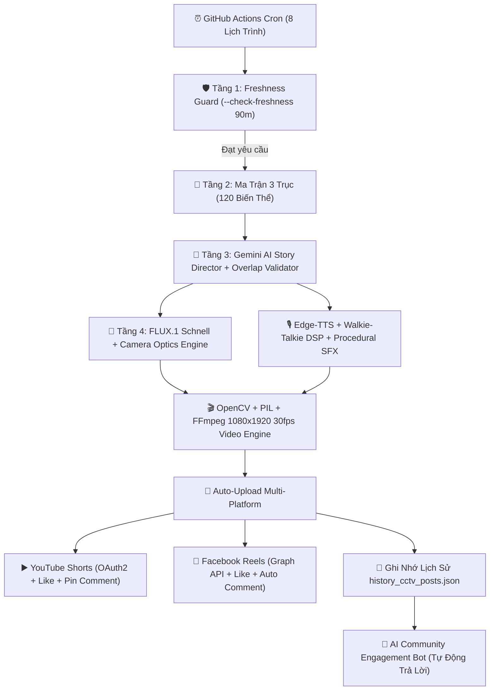

# 📹 24/7 AI FOUND FOOTAGE & SURVEILLANCE VIDEO BOT (SHORTS & REELS)

Hệ thống tự động hóa 100% (24/7 Cloud AI Bot) chạy trên GitHub Actions với **chi phí 0 ĐỒNG**. Bot tự động sáng tạo kịch bản, vẽ hình ảnh siêu thực qua FLUX.1, lồng tiếng Edge-TTS phong cách bộ đàm/cảnh sát, dựng video camera an ninh/bodycam/dashcam/trailcam với đầy đủ HUD timestamp mili-giây, hiệu ứng rung lắc tự nhiên, scanlines và vòng tròn đỏ highlight dị thường, sau đó tự xuất bản lên **YouTube Shorts** và **Facebook Reels** đúng 4 ca vàng mỗi ngày, tự like, ghim bình luận kích thích tranh luận và dùng AI tự động trả lời người xem.

---

## 🏗️ 1. KIẾN TRÚC HỆ THỐNG (ARCHITECTURE)



---

## 🔑 2. DANH SÁCH KEY & TOKEN CẦN CHUẨN BỊ (100% MIỄN PHÍ)

Bạn chỉ cần tạo các Key/Token miễn phí theo bảng dưới đây:

| Tên Secret | Nền tảng | Chi phí | Mục đích | Cách lấy |
| :--- | :--- | :--- | :--- | :--- |
| `GEMINI_API_KEY` | Google AI Studio | **Miễn phí** | Đạo diễn kịch bản & AI trả lời bình luận | [Google AI Studio](https://aistudio.google.com/app/apikey) |
| `HF_TOKEN` | Hugging Face | **Miễn phí** | Tạo ảnh FLUX.1-schnell góc nhìn camera | [Hugging Face Settings](https://huggingface.co/settings/tokens) (Tạo token quyền `Read`) |
| `YOUTUBE_CLIENT_ID` | Google Cloud Console | **Miễn phí** | Tải lên YouTube Shorts tự động | Xem hướng dẫn bên dưới |
| `YOUTUBE_CLIENT_SECRET` | Google Cloud Console | **Miễn phí** | Xác thực OAuth2 với Google | Xem hướng dẫn bên dưới |
| `YOUTUBE_REFRESH_TOKEN` | YouTube OAuth2 | **Miễn phí** | Token vĩnh viễn không bao giờ hết hạn | Chạy file `python setup_oauth_youtube.py` một lần duy nhất |
| `FB_PAGE_ID` | Meta for Developers | **Miễn phí** | ID Fanpage đăng Facebook Reels | ID trang Facebook của bạn |
| `FB_PAGE_ACCESS_TOKEN` | Meta Graph API | **Miễn phí** | Token Page vĩnh viễn (`expires_at: 0`) | Xem hướng dẫn lấy token vĩnh viễn bên dưới |
| `NOTIFICATION_WEBHOOK` | Discord / Telegram | Tùy chọn | Báo tin nhắn mỗi khi đăng video xong | Webhook URL của kênh Discord / Telegram |

---

## 🛠️ 3. HƯỚNG DẪN CHI TIẾT TỪNG BƯỚC LẤY TOKEN

### Bước 3.1: Lấy `GEMINI_API_KEY` (30 giây)
1. Truy cập [https://aistudio.google.com/app/apikey](https://aistudio.google.com/app/apikey).
2. Đăng nhập tài khoản Google và bấm **Create API key**.
3. Copy API Key lưu lại.

### Bước 3.2: Lấy `HF_TOKEN` (Hugging Face) (1 phút)
1. Truy cập [https://huggingface.co/settings/tokens](https://huggingface.co/settings/tokens).
2. Đăng ký/Đăng nhập tài khoản Hugging Face miễn phí.
3. Bấm **Create new token**, chọn loại `Read`, đặt tên bất kỳ và bấm **Generate a token**.
4. Copy Token bắt đầu bằng `hf_...`.

### Bước 3.3: Lấy bộ 3 Secret YouTube (`CLIENT_ID`, `CLIENT_SECRET`, `REFRESH_TOKEN`)
1. Truy cập [Google Cloud Console](https://console.cloud.google.com/).
2. Tạo 1 Project mới (ví dụ: `CCTV-Shorts-Bot`).
3. Vào mục **APIs & Services** -> **Library** -> Tìm kiếm `YouTube Data API v3` và bấm **Enable**.
4. Vào mục **OAuth consent screen**:
   - Chọn **External** -> Bấm Create.
   - Điền tên App (ví dụ: `CCTV Bot`) và email của bạn.
   - Tại tab **Scopes**, thêm `https://www.googleapis.com/auth/youtube.upload` và `https://www.googleapis.com/auth/youtube.force-ssl`.
   - Tại tab **Test users**, thêm email Google của chính bạn.
5. Vào mục **Credentials** -> **Create Credentials** -> **OAuth client ID**:
   - Application type: Chọn **Desktop app**.
   - Bấm Create -> Copy `Client ID` và `Client Secret`.
6. **Lấy Refresh Token vĩnh viễn bằng 1 lệnh:**
   Mở terminal tại thư mục dự án và chạy:
   ```bash
   python setup_oauth_youtube.py
   ```
   Dán `Client ID` và `Client Secret` vừa lấy vào. Trình duyệt sẽ mở ra, bạn đăng nhập tài khoản YouTube và cấp quyền. Terminal sẽ in ra `YOUTUBE_REFRESH_TOKEN` vĩnh viễn!

### Bước 3.4: Lấy `FB_PAGE_ID` & `FB_PAGE_ACCESS_TOKEN` (Facebook Reels)
1. Truy cập [Meta for Developers](https://developers.facebook.com/) -> Bấm **My Apps** -> **Create App** (Chọn loại *Business* hoặc *Other*).
2. Truy cập [Graph API Explorer](https://developers.facebook.com/tools/explorer/):
   - Chọn App của bạn.
   - Thêm các quyền: `pages_show_list`, `pages_read_engagement`, `pages_manage_posts`, `publish_video`.
   - Chọn Page của bạn tại dropdown **User or Page**.
   - Bấm **Generate Access Token**.
3. Chuyển thành Token vĩnh viễn không bao giờ hết hạn:
   - Dùng công cụ [Access Token Debugger](https://developers.facebook.com/tools/debug/accesstoken/).
   - Dán token vào -> Bấm **Extend Access Token** để nhận token có `expires_at: Never (0)`.

---

## 🚀 4. CÀI ĐẶT LÊN GITHUB & KÍCH HOẠT 24/7

### Bước 4.1: Đẩy mã nguồn lên GitHub Repo bí mật (Private Repo)
```bash
git init
git add .
git commit -m "feat: 24/7 cctv found footage video bot"
git branch -M main
git remote add origin https://github.com/YOUR_USERNAME/cctv-found-footage-bot.git
git push -u origin main
```

### Bước 4.2: Thêm Secrets vào GitHub Repo
Vào GitHub Repo của bạn trên web:
1. Chọn **Settings** -> **Secrets and variables** -> **Actions** -> Bấm **New repository secret**.
2. Thêm lần lượt 7 secrets sau:
   - `GEMINI_API_KEY`
   - `HF_TOKEN`
   - `YOUTUBE_CLIENT_ID`
   - `YOUTUBE_CLIENT_SECRET`
   - `YOUTUBE_REFRESH_TOKEN`
   - `FB_PAGE_ID`
   - `FB_PAGE_ACCESS_TOKEN`
   - `NOTIFICATION_WEBHOOK` (Tùy chọn)

### Bước 4.3: Kích hoạt chạy thử nghiệm ngay lập tức
1. Vào tab **Actions** trên GitHub.
2. Chọn workflow **24/7 CCTV & Found Footage AI Bot** ở menu bên trái.
3. Bấm **Run workflow**:
   - Tích chọn `force` để bỏ qua đệm 90 phút.
   - Bấm nút xanh **Run workflow**.
4. Máy ảo GitHub Actions sẽ khởi động trong chưa đầy 15 giây, dựng video và xuất bản trực tiếp lên kênh của bạn!

---

## ⏰ 5. LỊCH ĐĂNG 4 CA VÀNG TỰ ĐỘNG

Workflow được thiết lập tự động chạy mỗi ngày theo múi giờ Việt Nam (GMT+7) với cơ chế tự phục hồi nếu có ca bị trễ:

- **Ca 1 (Đêm khuya / Mỹ chiều)**: 03:15 VN (Cứu hộ: 03:45)
- **Ca 2 (Sáng sớm)**: 07:15 VN (Cứu hộ: 07:45)
- **Ca 3 (Giờ tan tầm)**: 19:15 VN (Cứu hộ: 19:45)
- **Ca 4 (Trước khi ngủ)**: 23:15 VN (Cứu hộ: 23:45)

Bộ lọc `--check-freshness 90` đảm bảo nếu ca chính `:15` đã chạy thành công, ca cứu hộ `:45` sẽ tự động thoát trong 1 giây để bảo vệ kênh không bị đăng trùng.

---

## 🧪 6. CHẠY THỬ NGHIỆM TRÊN MÁY TÍNH CỦA BẠN (LOCAL TEST)

Bạn có thể chạy thử tạo video xem ngay trên máy mà không cần upload:

```bash
# Tạo thử video góc nhìn CCTV (chế độ Dry Run - không đăng)
python -m src.pipeline --dry-run --force --mode CCTV

# Tạo thử video góc nhìn Cảnh sát Bodycam
python -m src.pipeline --dry-run --force --mode BODYCAM

# Tạo thử video góc nhìn Camera hành trình Dashcam
python -m src.pipeline --dry-run --force --mode DASHCAM

# Tạo thử video góc nhìn Camera bẫy thú Trail Cam
python -m src.pipeline --dry-run --force --mode TRAIL_CAM
```
Video hoàn chỉnh sẽ xuất hiện ngay trong thư mục `output/` với độ phân giải chuẩn dọc 1080x1920 30FPS!
